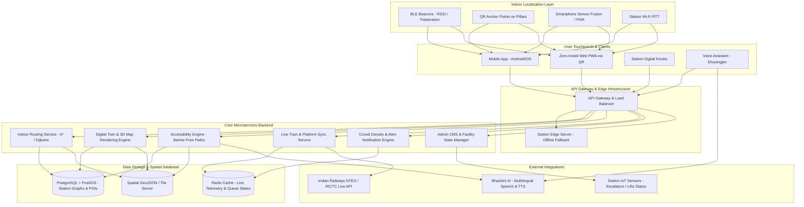

# Smart India Hackathon Workshop
# Date:
## Register Number:
## Name:
## Problem Title
SIH 1710: Enhancing Navigation for Railway Station Facilities and Locations
## Problem Description
Background: Railway stations are complex environments with numerous facilities and locations such as ticket counters, platforms, restrooms, food courts, and waiting areas. Passengers often face difficulties in navigating these spaces, especially in large or unfamiliar stations. Efficient and user-friendly navigation systems are crucial for improving passenger experience, reducing congestion, and ensuring timely travel connections. Description: The problem involves developing a comprehensive navigation solution for railway stations that assists passengers in locating various facilities and destinations within the station premises. This includes creating detailed maps, providing real-time directions, and integrating features such as accessibility options for individuals with disabilities. The solution should be intuitive, easy to use, and accessible via multiple platforms, including mobile devices and digital kiosks. Key challenges include updating navigation information in real-time, ensuring accuracy, and accommodating the diverse needs of all passengers. Expected Solution: The expected solution is a multi-platform navigation system that provides detailed, real-time directions to all facilities and locations within a railway station. This system should include: A mobile application with 3D interactive maps and step-by-step navigation. Digital kiosks located throughout the station with touch-screen interfaces. Voice-guided navigation for visually impaired passengers. Regular updates to reflect changes in station layout and facility locations. Integration with existing railway apps and services for seamless user experience. The solution should enhance the overall passenger experience by reducing confusion, saving time, and improving accessibility within the station.

## Problem Creater's Organization
Ministry of Railway

## Idea
**RailNav 360 (SmartStation Navigator)** is an AI-powered, multi-platform indoor navigation and passenger assistance ecosystem designed specifically for complex Indian railway stations. It solves the critical challenge of GPS unreliability in covered station environments by combining **Hybrid Indoor Positioning (BLE Beacons, Wi-Fi RTT, QR-based Visual Anchors, and Pedestrian Dead Reckoning)** with interactive 2.5D/3D station digital twin maps.

The system delivers frictionless navigation via:
1. **Zero-Install Web/PWA & Mobile App:** Accessible instantly by scanning QR codes deployed across station entry gates and pillars, or via dedicated mobile apps.
2. **Interactive Smart Digital Kiosks:** Touch-screen terminals with "Scan to Transfer Route to Mobile" functionality.
3. **Divyangjan-First Inclusive Design:** Dedicated accessibility routing (wheelchair/barrier-free routes prioritizing lifts and ramps), high-contrast display modes, and multi-lingual voice navigation powered by Bhashini AI.
4. **Live Railway Sync:** Real-time synchronization with Indian Railways NTES/IRCTC feeds to automatically update platform change alerts and re-calculate routes dynamically.

---

## Proposed Solution / Architecture Diagram

### Detailed Solution Workflow
1. **Indoor Positioning & Localization:** 
   - Uses low-cost BLE (Bluetooth Low Energy) beacons installed every 15–20 meters across platforms, foot overbridges (FOBs), concourses, and subways.
   - Station pillars and signboards feature high-visibility QR anchor points for instant zero-drift calibration.
   - Sensor fusion combines smartphone accelerometer/gyroscope (Pedestrian Dead Reckoning) with beacon signal strength (RSSI/Trilateration).

2. **Dynamic Routing Engine:**
   - Station floorplans are digitized into multi-level spatial topological graphs using PostGIS and pgRouting.
   - Weighted A* / Dijkstra algorithm accounts for live factors: platform alterations, crowd congestion density, and user-selected preferences (e.g., luggage-friendly or wheelchair-accessible paths).

3. **Multi-Modal Client Interfaces:**
   - **Mobile App / WebApp:** 3D interactive indoor maps (MapLibre/Three.js) with turn-by-turn AR overlay and step-by-step voice guidance.
   - **Digital Station Kiosks:** Station entry kiosks provide route search, printouts, and dynamic QR generation to seamlessly transfer the route directly into the passenger's smartphone browser.

4. **Station Master & Admin CMS:**
   - Real-time portal to update facility states (e.g., lift under maintenance, escalator direction change, temporary platform cordoning) and trigger emergency evacuation paths.

### Architecture Diagram

---

## Use Cases

1. **Unfamiliar Passenger Navigating to Platform:**
   - *Scenario:* A passenger arrives at New Delhi Railway Station 15 minutes before departure and needs to reach Platform 12 with heavy luggage.
   - *Flow:* Passenger scans the QR code at the entrance, types the train number or PNR, and gets an interactive path directing them to the nearest luggage ramp, escalator, and directly to their platform and coach position.

2. **Accessibility-Focused Routing for Divyangjan & Senior Citizens:**
   - *Scenario:* A passenger on a wheelchair or a senior citizen needing barrier-free access.
   - *Flow:* The user activates "Wheelchair Accessible Mode" or "Voice Navigation". The routing engine excludes staircases and foot overbridges without elevators, routing strictly through accessible lifts, designated ramps, and dedicated Divyangjan battery car pickup points.

3. **Sudden Platform Change Handling:**
   - *Scenario:* Station announcements change the arriving train from Platform 3 to Platform 8.
   - *Flow:* The app receives an instant push notification via the NTES sync integration, reroutes the passenger dynamically from their current indoor coordinate, and gives step-by-step guidance to Platform 8.

4. **Locating Key Station Amenities & Services:**
   - *Scenario:* A transit passenger with a 3-hour layover looking for cloakrooms, IRCTC executive lounges, child feeding pods, or medical aid booths.
   - *Flow:* The user searches for specific points of interest (POIs). The system displays live operating hours, walking distance, current occupancy level, and navigation directions.

5. **Station Kiosk to Mobile Handoff:**
   - *Scenario:* A passenger who does not have mobile internet or prior app installation uses a touch kiosk at the station lobby.
   - *Flow:* Passenger finds the booking counter and food court on the kiosk map. The kiosk generates an offline-ready route QR code; scanning it loads the turn-by-turn map directly onto their phone's local storage without app download.

6. **Emergency Evacuation Assistance:**
   - *Scenario:* Fire alarm or sudden crowd crush risk at a foot overbridge.
   - *Flow:* Station master initiates Emergency Protocol; all kiosks and active mobile sessions switch to green illuminated safety evacuation paths guiding users to the nearest open exits, avoiding congested hazard zones.

---

## Technology Stack

| Domain | Technologies & Frameworks |
|---|---|
| **Mobile & Frontend** | React Native / Flutter (Mobile Apps), Next.js / PWA (Web & Kiosk interface), Tailwind CSS |
| **3D Indoor Mapping** | Three.js, WebGL, MapLibre GL, Blender (Station 3D model asset generation) |
| **Indoor Positioning & Tracking** | Bluetooth Low Energy (BLE - iBeacon standard), Pedestrian Dead Reckoning (PDR), OpenCV / WebXR (Visual Anchor QR Tracking) |
| **Backend & Microservices** | Node.js (Express / NestJS) or Python (FastAPI), WebSockets (Real-time socket alerts) |
| **Spatial Engine & Database** | PostgreSQL + PostGIS (Spatial routing graph), pgRouting, Redis (In-memory caching of beacon telemetry) |
| **Voice & Multilingual AI** | Bhashini API (Government of India multi-lingual speech-to-text and voice synthesis) |
| **DevOps & Edge Deployment** | Docker, Kubernetes, NGINX, Station Edge Mini-PC / Raspberry Pi Gateway (Offline station local fallback) |

---

## Dependencies

### Hardware Dependencies
- **BLE Beacons:** Battery-operated or PoE Bluetooth 5.0 beacons installed along platforms, concourses, stairwells, and FOBs (approx. 20m grid).
- **Physical QR Anchor Signage:** Scratch-resistant, high-contrast QR markers on station pillars at eye level for visual indoor positioning resets.
- **Station Touchscreen Kiosks:** Industrial touch-screen terminals with thermal paper printers and camera/QR scanner peripherals.
- **Station Edge Server:** Local on-premise edge computing node (connected to RailWire LAN) ensuring navigation stays operational even during internet WAN downtime.

### Software & API Dependencies
- **PostGIS & pgRouting Extension:** Spatial geometric calculations and graph edge weight computations for indoor paths.
- **Indian Railways NTES / IRCTC Open APIs:** Real-time train schedules, delays, and dynamic platform allotment data feeds.
- **Bhashini Language Services:** Speech recognition and synthesis models supporting 12+ scheduled Indian languages.
- **Node.js / Python Runtime & Libraries:** `@turf/turf` (geospatial analysis), `three` (3D web view), `socket.io` (live notifications).
- **Security & Privacy Framework:** Anonymized telemetry compliance respecting passenger data privacy without persistent personal location tracking.
